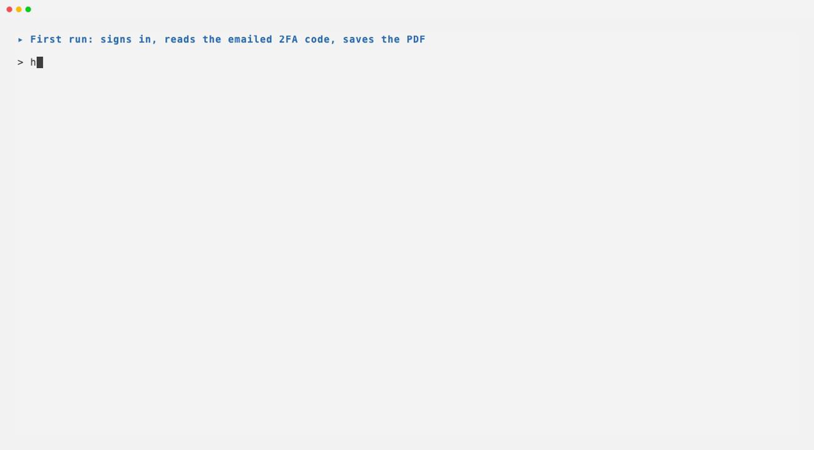
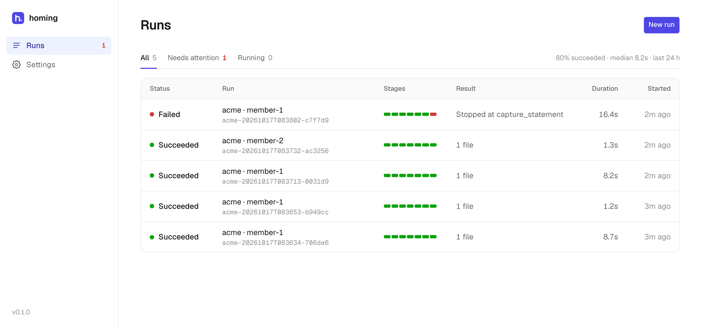

# homing

Hands-free browser automation for websites without an API.

homing signs in (second factor included), walks to a form, fills it in, saves
the document the site produces, and records what it did. Describe a website once
in a recipe; every run after that is repeatable. No AI in the loop.



## Features

- **Signs in on its own:** 2FA codes from an authenticator secret or an inbox.
- **Remembers the session:** later runs skip the login; dead sessions are
  caught.
- **Survives page changes:** each field is found several ways.
- **Saves documents:** downloads, new tabs, print to PDF.
- **Explains failures:** screenshot, page and logs, with secrets removed.
- **Resumes** from the step that failed, without logging in again.

## Quick start

Needs [uv](https://docs.astral.sh/uv/), `make`, and a GitHub account with
authenticator-app 2FA (plus the [GitHub CLI](https://cli.github.com) signed in
to it).

```bash
make setup        # install and create .env
$EDITOR .env      # GITHUB_USERNAME, GITHUB_PASSWORD, GITHUB_TOTP_SECRET
make bootstrap    # private scratch repo with two releases
make run          # log in, fill the release form, save the documents
make verify-live  # every check from the assignment, end to end
```

No GitHub account? `make test` runs the same scenarios against a bundled mock
portal (needs Docker).

| Variable             | Purpose                                      |
| -------------------- | -------------------------------------------- |
| `GITHUB_USERNAME`    | GitHub login                                 |
| `GITHUB_PASSWORD`    | GitHub password                              |
| `GITHUB_TOTP_SECRET` | authenticator setup key                      |
| `SESSION_KEY`        | encrypts the saved session (`make setup`)    |
| `HOMING_HOME`        | optional: where runs and sessions are stored |

## Usage

```bash
homing run -r github -i inputs/local/github-v0.1.0.json
homing resume RUN_ID
homing runs list
homing serve      # dashboard at http://127.0.0.1:8000
```

A different search term, date or order is a new inputs file, not a code change.
Each run leaves `runs/<id>/` with a JSON manifest, the documents, and evidence
if it failed. `samples/` has a real success and failure from GitHub.



## How it works

<details>
<summary>How the code arrives, and what happens when it is wrong</summary>

homing computes the current code from the authenticator secret, like a phone
app. If the site rejects it, homing waits for the next code and tries once more;
a second rejection stops the run. Codes never reach logs, records or evidence.
Sites that email codes are read over IMAP.

</details>

<details>
<summary>How a dead session is detected</summary>

The saved session is encrypted. On the next run homing checks that the right
user is signed in: the page must name the account and show something only that
account can see. Not being redirected to the login page proves nothing; GitHub
shows a signed-out page without redirecting. Otherwise it logs in again and
records why.

</details>

<details>
<summary>Locator strategy order, and why</summary>

Role and name, then label, nearby text, position in a section, and finally CSS
id or class: from what a person sees to how the page happens to be built. A
strategy wins only on exactly one visible match. A win by a later strategy is
flagged, so recipes are fixed before they break. It runs offline on saved pages,
and survives renamed classes, reordered elements, extra wrappers and iframes.

</details>

<details>
<summary>Portal quirks handled</summary>

A native download (the release asset), print to PDF (the draft release), and a
dependent field (the previous-tag picker appears only after a new tag). Iframes
and new tabs are proven on the mock portal.

</details>

<details>
<summary>Which failures retry</summary>

Timeouts, network and server errors retry up to three times with growing waits.
Everything else stops at once: wrong password, a code rejected twice, a missing
field, a captcha (never solved), a blocked write, or a failure after a write may
have happened.

</details>

<details>
<summary>What I would change first for a hundred portals</summary>

Recipes in version control with CI replaying saved pages; many workers on a
shared database, one run per account at a time; a secrets manager for
credentials; scheduled canary runs and drift alerts per portal; shared recipes
for portals built on the same platform.

</details>

## Limitations

Authenticator-app 2FA only (no SMS). Captchas stop the run. The dashboard has no
login and only listens locally.

## License

MIT
